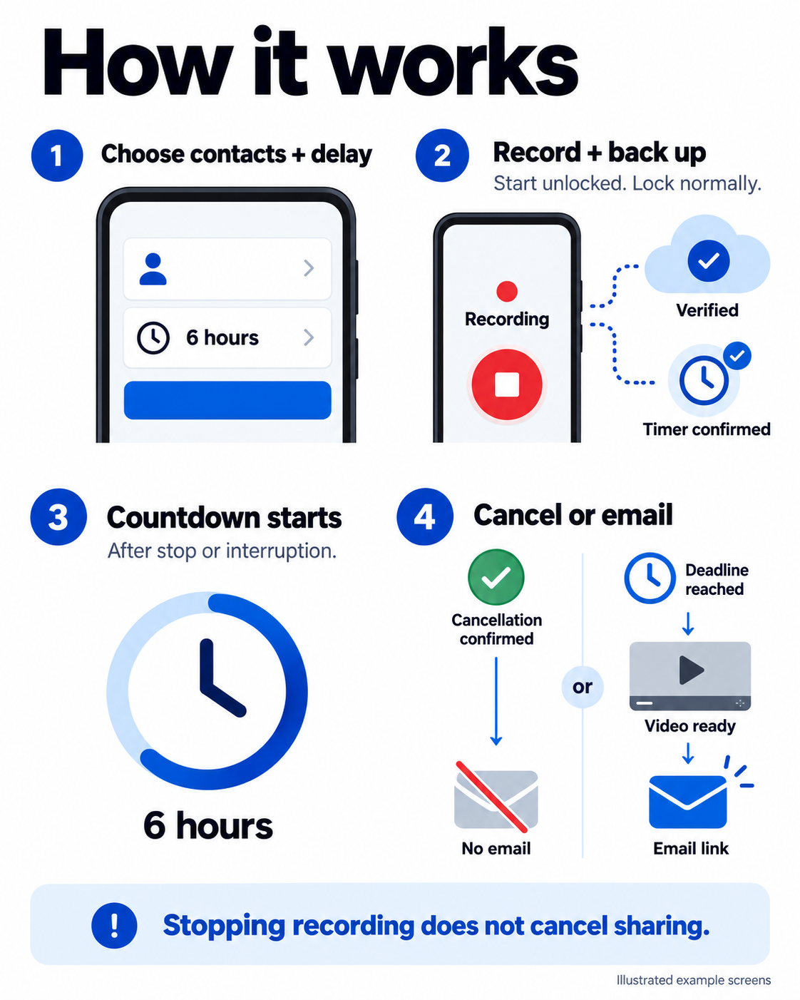

# Evidence Recorder

Public welcome and Android installation guide: https://abdylan.github.io/

Download the signed Android release from the website or GitHub Releases.
The current APK is version 804.1.3 (40.1 MB), with debugging disabled.
GPS continues during audio-only capture. After the first fix, updates require at
least 30 seconds and 25 metres of movement, accounting for GPS accuracy. Offline
location history is retained; GPS payload uploads, including backlog, remain at
least 30 seconds apart.
Video stops at the selected 10–30-minute limit. Audio can continue until 10% battery,
with speech-selected clips uploaded to the cloud. Unlocked manual Stop remains available.
After updating, open the app once while unlocked to prepare storage. Pending uploads
can then resume after reboot before the first unlock, subject to Android scheduling
and network availability.
The app checks simultaneous camera support and otherwise uses the rear camera and
microphone. It does not alternate cameras. The preview stays inside the open app.
When the camera check passes, the app uses the widest rear view with the normal
front camera. The S24 Ultra passed at 0.6x; the A07 uses normal rear-only capture.
Public versions always use 804.minor.patch; the major number 804 is permanent.
Android 11 or later is required. It uses the same release signing key as version 0.8.

Ask the app owner for your own private invitation link, QR code or eight-character
connection code. Share this README freely; send invitations separately and privately.
Do not publish real invitations in this repository or in public issues.

Open your private link or scan its QR code. If needed, install the APK, return to
that same invitation, and tap **Connect this phone**. Confirm **Connect** in the app.
Alternatively, open **Evidence Recorder**, tap **Connect this phone**, and enter
your code. The website can check available, expired and already-used states;
viewing it does not claim the invitation. Each invitation connects one phone and
expires 48 hours after creation. An established phone connection does not expire
with its invitation.

This repository contains the public website and signed APK assets only. AWS
handles invitations, device authentication, private recordings and release timers.
No recordings, user lists, device credentials or real invitation codes are published.
The invitation page has no analytics, cookies or browser storage. Keep its private
link safe: it can remain in browser history and messages.

An ordinary public APK cannot replace an existing debug-signed installation.
An owner-assisted signing-key migration is required for an in-place update.
Keep your existing app if recordings or uploads are pending, and contact the owner
before changing it. Do not uninstall or clear app data to bypass an update error.

To update the download, change the public APK URL and metadata in site-config.js.
Keep connect/, .well-known/assetlinks.json and .nojekyll when publishing.
Never store credentials, real invitation codes or signed storage URLs here.

## How it works

Illustrated example screens. Choose contacts and a delay, start recording, check
cloud backup and timer confirmation, stop or cancel sharing, and receive an email.
Stopping recording does not cancel sharing. Email attempts wait for the release
deadline and a verified combined video. Provider acceptance does not confirm delivery.
The [welcome page](https://abdylan.github.io/#how-it-works) includes a text version
and a link to the full-size image. The six-hour setting is an example.
