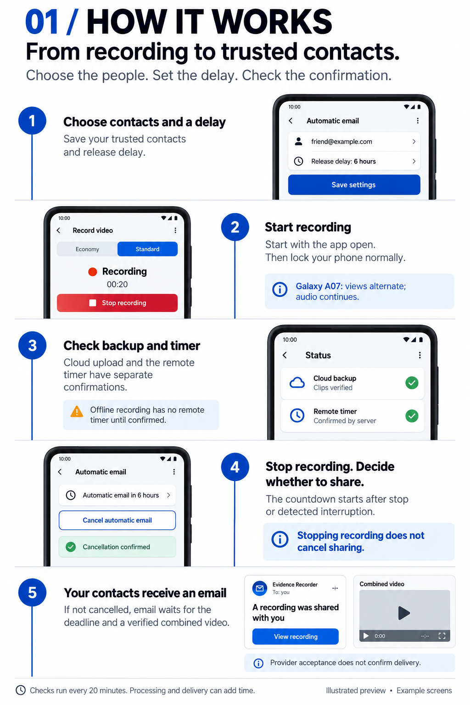

# Evidence Recorder

Public welcome and Android installation guide: https://abdylan.github.io/

Download the signed Android release from the website or GitHub Releases.
The current APK is version 0.9-invitation-links (7.6 MB), with debugging disabled.
Android 11 or later is required. It uses the same release signing key as version 0.8.

Ask the app owner for your own private invitation link, QR code or eight-character
connection code. Share this README freely; send invitations separately and privately.
Do not publish real invitations in this repository or in public issues.

Open your private link or scan its QR code. If needed, install the APK, return to
that same invitation, and tap **Connect this phone**. Confirm **Connect** in the app.
Alternatively, open **Evidence Recorder Dev**, tap **Connect this phone**, and enter
your code. The website can check available, expired and already-used states;
viewing it does not claim the invitation. Each invitation connects one phone and
expires 48 hours after creation. An established phone connection does not expire
with its invitation.

This repository contains the public website and signed APK assets only. AWS
handles invitations, device authentication, private recordings and release timers.
No recordings, user lists, device credentials or real invitation codes are published.
The invitation page has no analytics, cookies or browser storage. Keep its private
link safe: it can remain in browser history and messages.

Existing debug installations cannot update to the production signing key in place.
Keep your existing app if recordings or uploads are pending, and contact the owner
before changing it. Do not uninstall or clear app data to bypass an update error.

To update the download, change the public APK URL and metadata in site-config.js.
Keep connect/, .well-known/assetlinks.json and .nojekyll when publishing.
Never store credentials, real invitation codes or signed storage URLs here.

## How it works

Illustrated example screens. Choose contacts and a delay, start recording, check
cloud backup and timer confirmation, stop or cancel sharing, and receive an email.
Stopping recording does not cancel sharing. Email attempts wait for the release
deadline and a verified combined video. Provider acceptance does not confirm delivery.
The [welcome page](https://abdylan.github.io/#how-it-works) includes a text version
and a link to the full-size image. The six-hour setting is an example.
